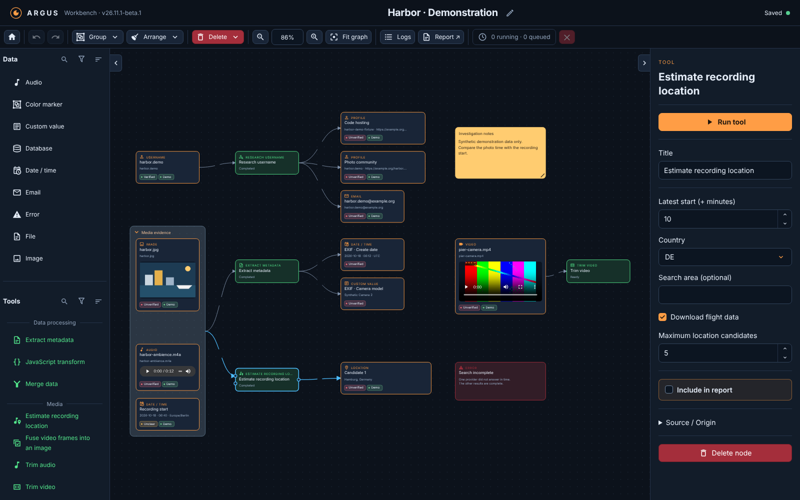
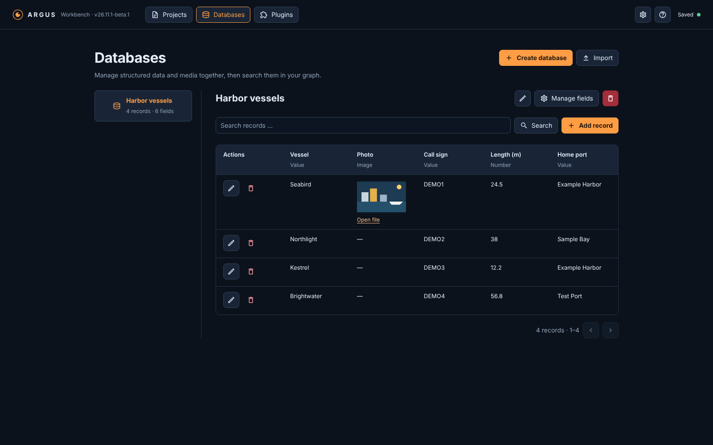
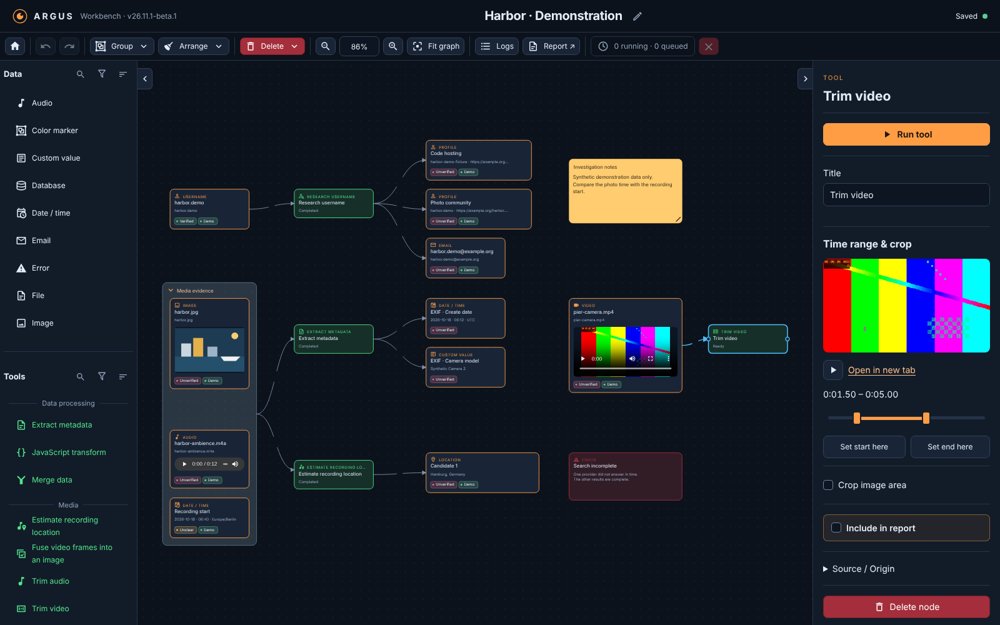
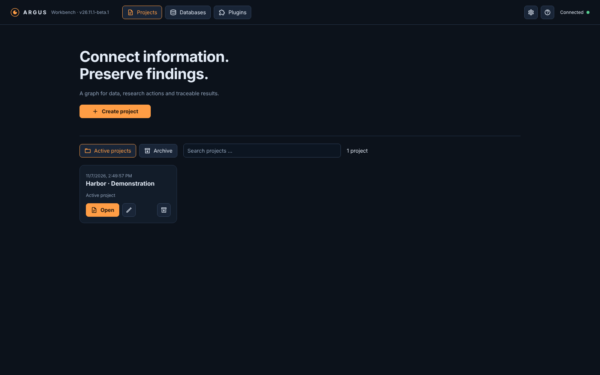
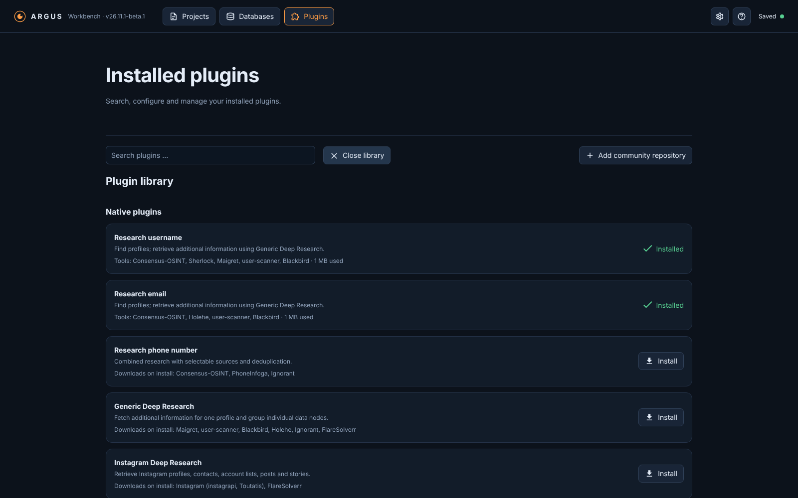
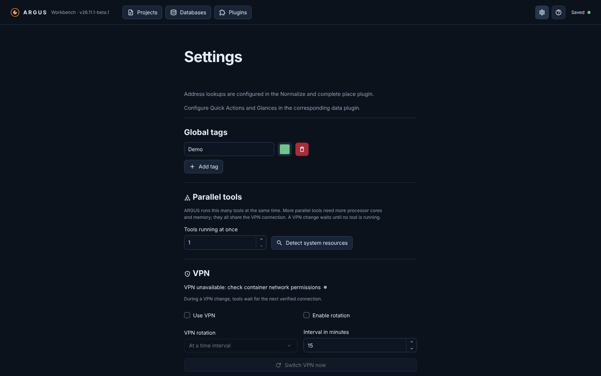

> [!CAUTION]
> **🚨 SECURITY WARNING – KNOWN MAJOR SECURITY CONCERNS**
>
> ARGUS currently has **open, unresolved security issues** that still need to be fixed (see issues [#1](../../issues/1), [#2](../../issues/2), [#3](../../issues/3), [#4](../../issues/4) and [#5](../../issues/5)).
>
> **Do not expose ARGUS to the internet or to untrusted networks.** Run it only in a trusted, isolated environment, keep the default localhost binding, and do not process sensitive data until these issues are resolved.

**Vibe-coded beta:** ARGUS is built through iterative, AI-assisted development. Review the code, validate findings and test your deployment before relying on it.

<p align="center"></p>
<h1 align="center">ARGUS</h1>
<p align="center"><strong>Connect information. Preserve findings.</strong></p>
<p align="center">V26.11.1 Beta 1 · Self-hosted OSINT workbench · Python + React · One container</p>

ARGUS turns research into a visual graph. Start with a username, email address, phone number, photo, video or audio file; connect a tool; explore the resulting profiles, media and evidence without losing the path back to their sources.



## Explore, connect, document

| Workspace | Research | Evidence |
| --- | --- | --- |
| Typed data and tool nodes, editable connections and nested groups | Username, email and phone discovery with multiple providers | Source details, verification status and custom tags |
| Drag tools onto compatible inputs and organize results with layouts | Separate profile deep research and ordered search profiles | Select findings for HTML reports and review execution logs |
| Inline previews, quick actions and autosave | Parallel tools with a persistent queue, cancellation and partial-result warnings | Project archives, revision reconciliation and local file storage |

Discovery tools return accounts and profiles. Separate deep-research tools enrich a chosen profile. Results arrive as typed nodes (usernames, email addresses, links, dates and plain values) that can feed the next tool. The information returned depends on the upstream service and any configured credentials.

## Databases and imports

Maintain shared databases with typed fields, structured JSON and multiple image/file attachments. Preview and map CSV, TSV, XLSX, ODS, JSON, JSONL, XML and text imports before applying them. Add one record per image or collect attachments in one record.

Connect a Database node and a reference value to Search database for complete-record result groups. DeepFace also supports an image plus a selected database image column. See [database and import documentation](docs/databases.md). A searchable Help tab explains the main workflows inside ARGUS.



## Media and locations

- **Images and files:** uploads, local caching of remote images, metadata extraction, image cropping and inline previews.
- **Video:** inline playback, browser-compatible working copies when needed, graphical time-range and area cropping, and CPU multi-frame fusion from short sequences. Originals are preserved. See [video tools](docs/video.md).
- **Audio:** players on the canvas and in node details, trimming, and an optional estimate of where a recording was made (Dopplergeist plugin, noncommercial license).
- **Image comparison:** a configurable two-image DeepFace adapter with scores, detection overlays and optional reduced working copies. Upstream model licenses and first-use downloads apply.
- **Locations:** structured addresses, server-side map previews and quick actions for map providers.
- **Notes and markers:** editable notes and resizable colored areas to explain and organize findings.



## Make it your workspace

Create, rename and archive projects. Keep files with their project, group related findings and choose what goes into a report. The interface is in English, with themed date/time/color controls, searchable selectors and resizable sidebars.

| Projects | Plugins |
| --- | --- |
|  |  |

Plugins are installed from the library when you need them. Their configuration separates installation-wide settings from defaults that can be changed on individual tools. Data-node plugins configure their quick actions and previews. Provider priorities and search profiles can be reordered for the investigation.



Screenshots show the current interface with synthetic demonstration data, not real-person research or verified findings. `scripts/readme_screenshots.py` regenerates them.

## Run with Docker

Use a Linux Docker host with Docker Compose:

```sh
git clone https://github.com/NikGro/argus-osint.git
cd argus-osint
docker compose up -d --build
```

Open **http://127.0.0.1:8080/**. ARGUS starts without research plugins. Open **Plugins → Add plugins** and install the ones you need; ARGUS downloads each plugin and its tools (for example Sherlock, Maigret or DeepFace) into the data volume. The image itself holds only the application, Chromium, media libraries and the VPN controller.

The supplied Compose file declares the Linux capabilities and TUN device the integrated VPN needs. Its supervisor starts the VPN controller and then runs the application, its plugins and their tools unprivileged as UID 10001. **Settings → Parallel tools** sets how many tools run at once. See [runtime](docs/worker-runtime.md), [VPN configuration](docs/vpn.md) and [.env.example](.env.example).

ARGUS currently has no user-account login. Keep access within a trusted environment; the default binding is localhost. The interface targets desktop browsers; small-screen users see a desktop-mode notice.

**Synology:** `compose.synology.yaml` has the same permissions with fixed container, image and volume names for Container Manager. Add `COMPOSE_FILE=compose.synology.yaml` (and `BIND_ADDRESS=0.0.0.0` for access from your home network) to `.env`, then run `docker compose up -d --build`.

Projects, files, settings, encrypted credentials and sessions live in the data volume. Back up the complete volume, including encryption keys. Update with `docker compose up -d --build` and retain the volume.

## Optional VPN and logs

Configure OpenVPN or WireGuard profiles and rotate by interval or after a tool. The queue waits for changes; the integrated gateway applies fail-closed egress when VPN use is enabled. Confirm connectivity and interruption behavior on your target host. See [VPN documentation](docs/vpn.md).

Project logs track executions. System logs support search, export, auto-refresh and following new lines.

## Plugins, development and credits

- [Plugin guide and API contract](docs/PLUGIN_CONTRACT.md) · [examples](examples)
- [Architecture](ARCHITECTURE.md) · [contributing and validation](CONTRIBUTING.md)
- [Third-party versions and licenses](THIRD_PARTY.md) · [release notes](RELEASE_NOTES.md)

ARGUS integrates independent projects including [Consensus OSINT](https://github.com/OSINT-Experts-Society/Consensus-OSINT), [Sherlock](https://github.com/sherlock-project/sherlock), [Holehe](https://github.com/megadose/holehe), [Maigret](https://github.com/soxoj/maigret), [User Scanner](https://github.com/kaifcodec/user-scanner), [Ignorant](https://github.com/megadose/ignorant), [PhoneInfoga](https://github.com/sundowndev/phoneinfoga), [Blackbird](https://github.com/p1ngul1n0/blackbird), [FlareSolverr](https://github.com/FlareSolverr/FlareSolverr), [instagrapi](https://github.com/subzeroid/instagrapi), [Toutatis](https://github.com/megadose/toutatis), [DeepFace](https://github.com/serengil/deepface) and [Dopplergeist](https://github.com/1337isnot1337/DOPPLERGEIST). These projects do not endorse ARGUS. Map data © [OpenStreetMap](https://www.openstreetmap.org/copyright) contributors. Additional runtime, data, UI and model credits are in [THIRD_PARTY.md](THIRD_PARTY.md).

Original ARGUS code is [MIT licensed](LICENSE). Third-party components retain their terms; Blackbird and Dopplergeist are licensed for noncommercial use only. Check component licenses for your intended use.

Thanks to everyone who reported issues and security findings, and to the maintainers of the projects above.

Production uses Python and the checked-in frontend bundle; Node is for frontend development. See [CONTRIBUTING.md](CONTRIBUTING.md) for setup and checks. External services may require authentication, rate-limit queries or present interactive challenges. Independently verify findings.

---

<p align="center"><sub>Support development</sub><br/><a href="https://paypal.me/niklas664"></a></p>
