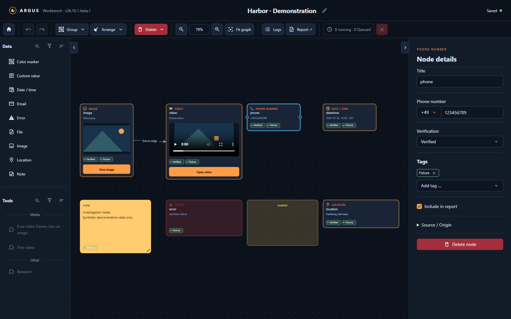
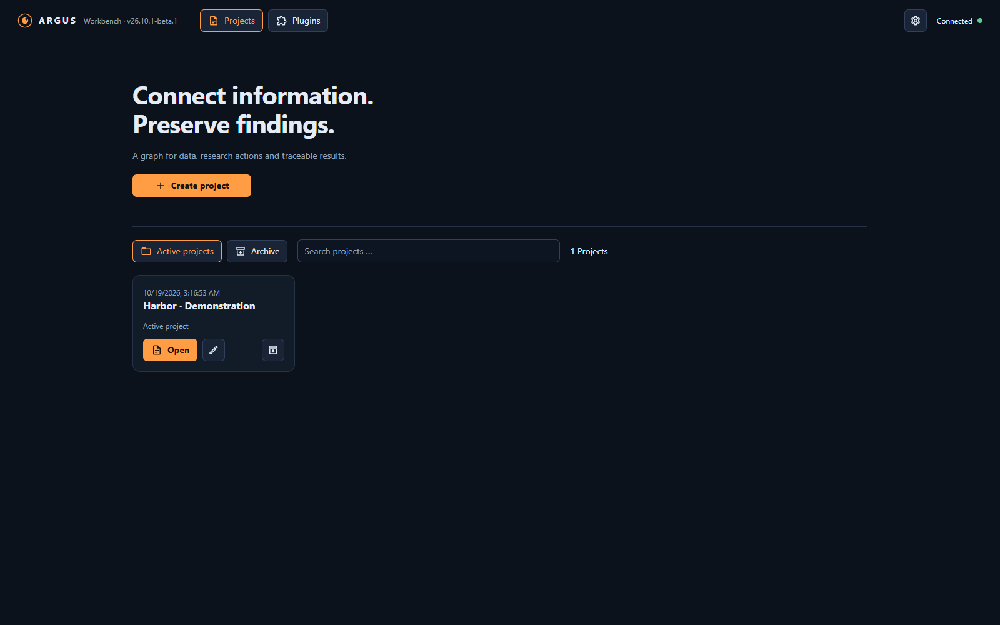
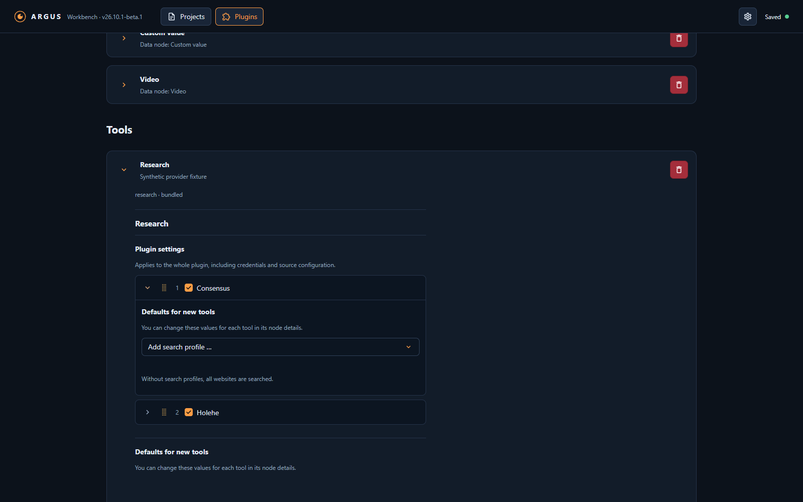
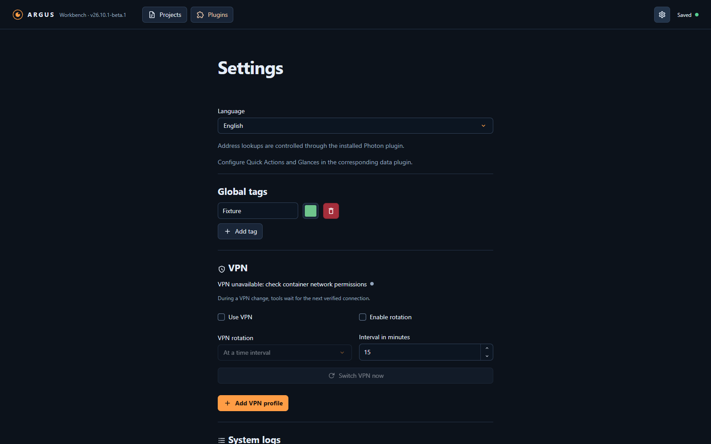

**Vibe-coded beta:** ARGUS is built through iterative, AI-assisted development. Review the code, validate findings and test your deployment before relying on it.

<p align="center"></p>
<h1 align="center">ARGUS</h1>
<p align="center"><strong>Connect information. Preserve findings.</strong></p>
<p align="center">V26.10.1 Beta 1 · Self-hosted OSINT workbench · Python + React · One container</p>

ARGUS turns research into a visual graph. Start with a username, email address, phone number or file; connect a tool; explore the resulting profiles, media and evidence without losing the path back to their sources.



## Explore, connect, document

| Workspace | Research | Evidence |
| --- | --- | --- |
| Typed data and tool nodes, editable connections and nested groups | Username, email and phone discovery with multiple providers | Source details, verification status and custom tags |
| Drag tools onto compatible inputs and organize results with layouts | Separate profile deep research and ordered search profiles | Select findings for HTML reports and review execution logs |
| Inline previews, quick actions and autosave | Persistent execution queue, cancellation and partial-result warnings | Project archives, revision reconciliation and local file storage |

Discovery tools return accounts and profiles. Separate deep-research tools enrich a chosen profile. The information returned depends on the upstream service and any configured credentials.

## Media and locations

- **Images and files:** uploads, local caching of remote images, metadata extraction, image cropping and inline previews.
- **Video:** inline playback, browser-compatible working copies when needed, graphical time-range and area cropping, and CPU multi-frame fusion from short sequences. Originals are preserved. See [video tools](docs/video.md).
- **Image comparison:** a configurable two-image DeepFace adapter with scores, detection overlays and optional reduced working copies. Upstream model licenses and first-use downloads apply.
- **Locations:** structured addresses, server-side map previews and quick actions for map providers.
- **Notes and markers:** editable notes and resizable colored areas to explain and organize findings.


## Make it your workspace

Create, rename and archive projects. Keep files with their project, group related findings and choose what goes into a report. ARGUS includes German and English interfaces, themed date/time/color controls, searchable selectors and resizable sidebars.

| Projects | Plugins |
| --- | --- |
|  |  |

Plugin configuration separates installation-wide settings from defaults that can be changed on individual tools. Data-node plugins configure their quick actions and previews. Provider priorities and search profiles can be reordered for the investigation.



Screenshots show the current interface with synthetic demonstration data, not real-person research or verified findings.

## Run with Docker

Use a Linux Docker host with Docker Compose:

```sh
git clone https://github.com/NikGro/argus-osint.git
cd argus-osint
docker compose up -d --build
```

Open **http://127.0.0.1:8080/**. The image includes the research engines, Chromium, media tools, VPN controller and isolated community workers. The first build is substantial; no browser or VPN sidecar is required.

The supplied Compose file declares the Linux capabilities and TUN device required by the integrated runtime. Its supervisor manages privileged networking while the application runs unprivileged. See [runtime setup](docs/worker-runtime.md), [VPN configuration](docs/vpn.md) and [.env.example](.env.example).

ARGUS currently has no user-account login. Keep access within a trusted environment; the default binding is localhost. The interface targets desktop browsers; small-screen users see a desktop-mode notice.

Projects, files, settings, encrypted credentials and sessions live in the data volume. Back up the complete volume, including encryption keys. Update with `docker compose up -d --build` and retain the volume.

## Optional VPN and logs

Configure OpenVPN or WireGuard profiles and rotate by interval or after a tool. The queue waits for changes; the integrated gateway applies fail-closed egress when VPN use is enabled. Confirm connectivity and interruption behavior on your target host. See [VPN documentation](docs/vpn.md).

Project logs track executions. System logs support search, export, auto-refresh and following new lines.

## Plugins, development and credits

- [Plugin guide and API contract](docs/PLUGIN_CONTRACT.md) · [examples](examples)
- [Architecture](ARCHITECTURE.md) · [contributing and validation](CONTRIBUTING.md)
- [Third-party versions and licenses](THIRD_PARTY.md) · [release notes](RELEASE_NOTES.md)

ARGUS integrates independent projects including [Consensus OSINT](https://github.com/OSINT-Experts-Society/Consensus-OSINT), [Sherlock](https://github.com/sherlock-project/sherlock), [Holehe](https://github.com/megadose/holehe), [Maigret](https://github.com/soxoj/maigret), [User Scanner](https://github.com/kaifcodec/user-scanner), [Ignorant](https://github.com/megadose/ignorant), [PhoneInfoga](https://github.com/sundowndev/phoneinfoga), [Blackbird](https://github.com/p1ngul1n0/blackbird), [FlareSolverr](https://github.com/FlareSolverr/FlareSolverr), [instagrapi](https://github.com/subzeroid/instagrapi), [Toutatis](https://github.com/megadose/toutatis) and [DeepFace](https://github.com/serengil/deepface). These projects do not endorse ARGUS. Additional runtime, UI and model credits are in [THIRD_PARTY.md](THIRD_PARTY.md).

Original ARGUS code is [MIT licensed](LICENSE). Third-party components retain their terms; the bundled Blackbird version has a noncommercial license. Check component licenses for your intended use.

Production uses Python and the checked-in frontend bundle; Node is for frontend development. See [CONTRIBUTING.md](CONTRIBUTING.md) for setup and checks. External services may require authentication, rate-limit queries or present interactive challenges. Independently verify findings.

---

<p align="center"><sub>Support development</sub><br/><a href="https://paypal.me/niklas664"></a></p>
